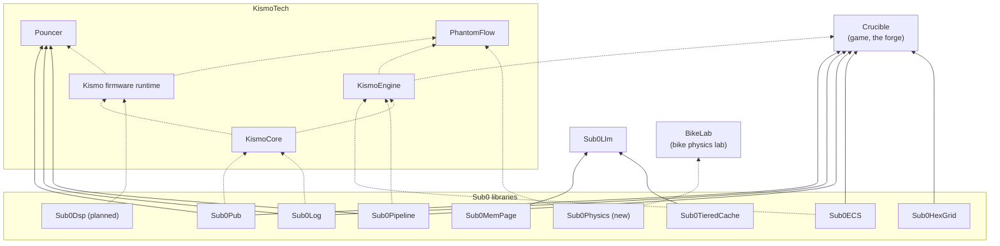

# Who uses Sub0

Dependencies point one way: projects depend on Sub0; Sub0 depends on none of them. This page only
*lists* users. Each user's architecture is documented in its own repository.

Solid arrows are current, pinned use; dashed arrows are planned. Read each arrow as "is used by".

| User | Uses | Where to read more |
|---|---|---|
| [Crucible](https://github.com/CraigHutchinson/Crucible) | Pub, Log, Pipeline, ECS, HexGrid | Its [reuse catalog](https://github.com/CraigHutchinson/Crucible/blob/main/docs/reuse/README.md) and [Sub0 roadmap](https://github.com/CraigHutchinson/Crucible/blob/main/docs/reuse/sub0-roadmap.md) |
| [Sub0Llm](https://github.com/CraigHutchinson/Sub0Llm) | MemPage, TieredCache | Its storage stack plan |
| [BikeLab](https://github.com/CraigHutchinson/BikeLab) | Physics (planned; the primitives are proven here first) | Its [physics fidelity architecture](https://github.com/CraigHutchinson/BikeLab/blob/main/docs/PHYSICS_FIDELITY.md) |
| Pouncer ([pouncer.uk](https://pouncer.uk)) | Pub, Log, Pipeline | A KismoTech product |
| [KismoCore](https://github.com/KismoTech/KismoCore), [KismoEngine](https://github.com/KismoTech/KismoEngine) | Planned | [KismoTech docs](https://github.com/KismoTech/.github/tree/main/docs) |
| PhantomFlow ([site](https://kismotech.github.io/PhantomFlow.uk/)) | Via the Kismo platform; Physics, under its own bike solvers (planned) | A KismoTech product |

Using a Sub0 library in your project? Open an issue in this repository to be listed.
